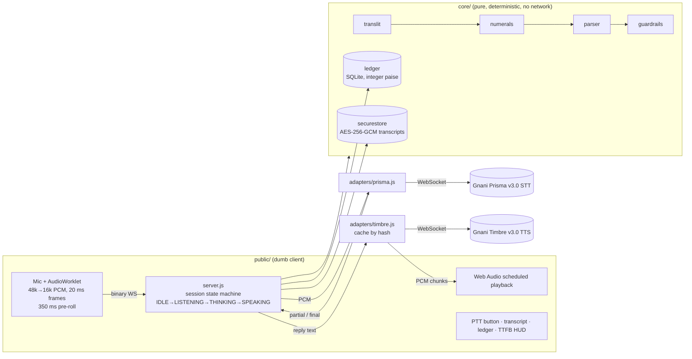

# Voice Khata

A voice ledger a kirana shopkeeper talks to across the counter.

> "रमेश का 340 उधार, कल 200 दिया था" → two entries (₹340 credit today, ₹200 payment yesterday) → spoken read-back with the
> new balance → saved on "हाँ". Corrections by voice ("नाही, 430"). Questions ("रमेश का टोटल?") answered at once.

Gnani Voice Hackathon, PS2.

## Gnani services used

**Prisma v3.0 STT, Timbre v3.0 TTS (WebSocket streaming).** No telephony. The orchestration loop is our own code
(`server.js`), not a hosted agent platform.

## Setup

Requires Node 22.5 or newer.

```sh
npm install
cp .env.example .env
node -e "console.log(require('crypto').randomBytes(32).toString('hex'))"   # paste into TRANSCRIPT_KEY
npm test
npm start            # http://localhost:3000
```

`MOCK_VOICE=1` (the default) runs the whole loop offline: Prisma returns canned transcripts in order
(`रमेश का 340 उधार, कल 200 दिया था` → `नाही, 430` → `हाँ` → `रमेश का टोटल?`) and Timbre returns a short beep.
Open the page, tap **Start**, then hold the button once per utterance.

### Going live with Gnani

1. Fill in every `GNANI_*` value in `.env` from the Gnani docs. Nothing is guessed in code; each read is marked
   `// TODO: VERIFY FROM GNANI DOCS`.
2. Record a short WAV and run `npm run probe -- ./sample.wav --lang hi`. It prints every raw Prisma WebSocket event
   and reports whether the transcript uses digits, Devanagari, Bengali or Latin script.
3. Set `MOCK_VOICE=0` and `npm start`.

### Scripts

| Command | What it does |
|---|---|
| `npm test` | Core unit tests (numerals, parser, ledger, guardrails, transliteration, encryption) |
| `npm start` | Web UI + WebSocket server on `PORT` |
| `npm run probe -- file.wav` | Stream a WAV to Prisma and print raw events |
| `npm run purge` | Delete all stored transcripts (`-- --all` also wipes the ledger) |

## Architecture



- `core/` is pure logic: no network, no API keys. Numerals, direction, dates and guardrails are deterministic code.
- `adapters/` is the only place Gnani is called.
- Push-to-talk release is the end of speech. There is no silence timeout.
- Latency is measured per turn (`speech_end`, `stt_final`, `intent_done`, `commit`, `tts_first_byte`, `play_start`).
  TTFB = `play_start − speech_end`, shown as rolling p50/p95 in the UI. Targets: p50 < 900 ms, p95 < 1.6 s.

## Compliance

- **AI disclosure:** the agent's first turn says it is an AI, in the session language, before any task. It repeats this
  when the language changes.
- **No lending:** loans, interest and EMI requests are refused by deterministic guardrails. There is no interest logic.
- **Reminders:** opt-in only. Reminder text is linted for threat or pressure language and blocked if found.
- **Voices:** stock Timbre voices only. No voice cloning.
- **Data:** synthetic customers only. The ledger is a local SQLite file. Transcripts are encrypted at rest with
  AES-256-GCM (`TRANSCRIPT_KEY`). Plaintext transcripts are never written to disk; the audit log stores only a transcript id.
  **Delete all demo data** in the UI, `POST /purge` or `npm run purge -- --all` wipes everything after judging.
- **Secrets:** the API key lives only in `.env` on the server. It is gitignored and never sent to the browser.
