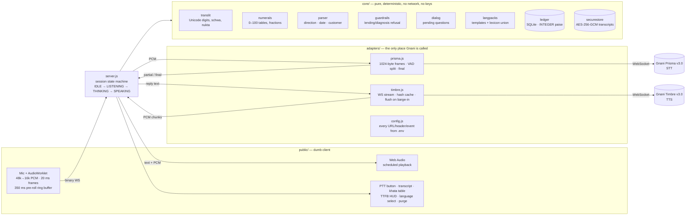
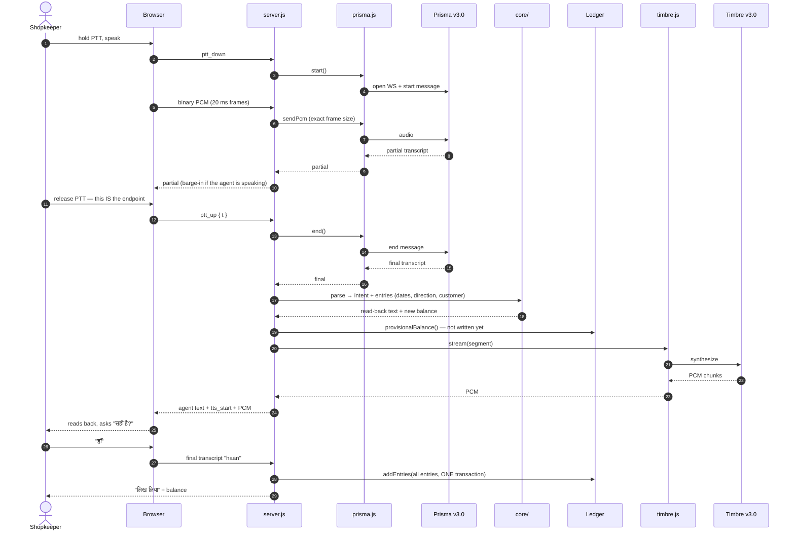
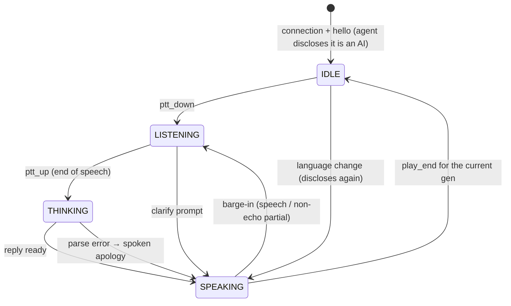
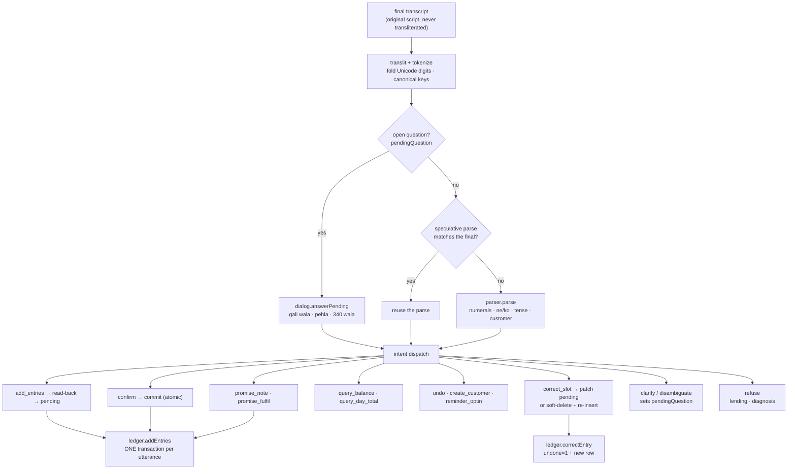
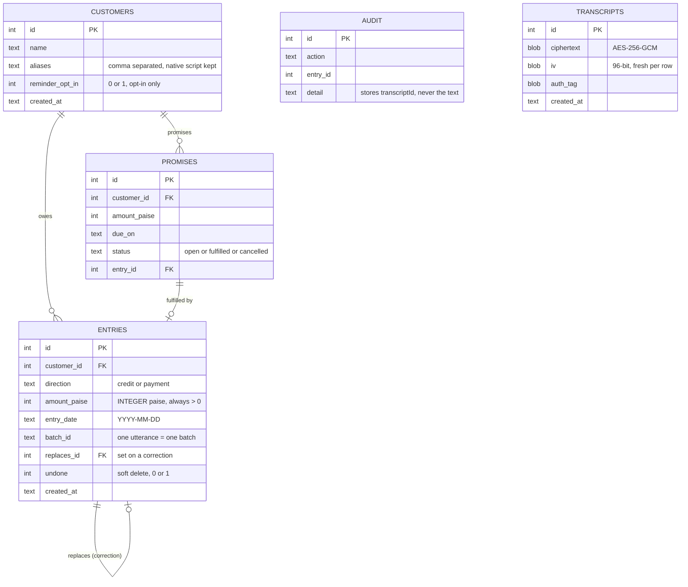

# Voice Khata

A voice ledger a kirana shopkeeper talks to across the counter.

> "रमेश का 340 उधार, कल 200 दिया था" → two entries (₹340 credit today, ₹200 payment yesterday) → spoken read-back with the
> new balance → saved on "हाँ". Corrections by voice ("नाही, 430"). Questions ("रमेश का टोटल?") answered at once.

Gnani Voice Hackathon, PS2.

## Gnani services used

**Prisma v3.0 STT, Timbre v3.0 TTS (WebSocket streaming).** No telephony. The orchestration loop is our own code
(`server.js`), not a hosted agent platform.

## Setup

Requires Node 22.5 or newer.

```sh
npm install
node -e "console.log(require('crypto').randomBytes(32).toString('hex'))"   # paste into TRANSCRIPT_KEY in .env
npm test
npm start            # http://localhost:3000
```

Create a local `.env` (never committed — no env file is tracked in this repo) when you have Gnani credentials. The
server needs only `GNANI_API_KEY`, `GNANI_AUTH_HEADER`, `GNANI_AUTH_VALUE`, `GNANI_LANG_MAP`, `GNANI_STT_WS_URL`,
`GNANI_STT_HEADERS`, `GNANI_STT_*_EVENT`, `GNANI_STT_*_FIELD`, `GNANI_TTS_WS_URL`, `GNANI_TTS_VOICE`,
`GNANI_TTS_REQUEST_TEMPLATE`, `GNANI_TTS_*_EVENT`, plus `TRANSCRIPT_KEY` and `MOCK_VOICE`. Every one of them is read
through `adapters/config.js`, which also lists the defaults; no URL or header is hard-coded anywhere else.

`MOCK_VOICE=1` (the default) runs the whole loop offline: Prisma returns canned transcripts in order and Timbre
returns a short beep. The synthetic demo roster (`data/demo-roster.json`) has two customers named रमेश (गली / स्टेशन),
so the script exercises disambiguation with short answers:
`रमेश का 340 उधार, कल 200 दिया था` → *कौन से रमेश?* → `gali wala` → `नाही, 430` → `हाँ` → `रमेश का टोटल?` → `गली वाला`.
Open the page, tap **Start**, then hold the button once per utterance. The mic, worklet and frame upload run in mock mode
too (level meter + frame counter); only the transcript is canned. The latency HUD reads "MOCK — not a real measurement".

Every turn can also be **typed** into the box under the mic button. A typed line takes the exact same server path as a
recognised final, so the whole loop (disambiguation, correction, commit, query) still demos with no microphone at all —
and a judge can try any sentence instead of the canned script.

Agent replies are spoken and shown in native script by default (`TTS_SCRIPT=native`: Devanagari / Bengali); set
`TTS_SCRIPT=latin` for romanised output. User transcripts are always shown exactly as recognised.

### Going live with Gnani

1. Fill in every `GNANI_*` value in your local `.env` from the Gnani docs. Nothing is guessed in code; each read is
   marked `// TODO: VERIFY FROM GNANI DOCS`.
2. Record a short WAV and run `npm run probe -- ./sample.wav --lang hi`. It prints every raw Prisma WebSocket event
   and reports whether the transcript uses digits, Devanagari, Bengali or Latin script.
3. Set `MOCK_VOICE=0` and `npm start`.

### Scripts

| Command | What it does |
|---|---|
| `npm test` | Core unit tests (numerals, parser, ledger, guardrails, transliteration, encryption) |
| `npm start` | Web UI + WebSocket server on `PORT` |
| `npm run probe -- file.wav` | Stream a WAV to Prisma and print raw events |
| `npm run purge` | Delete all stored transcripts (`-- --all` also wipes the ledger) |

## Architecture

### System topology



- `core/` is pure logic: no network, no API keys. Numerals, direction, dates and guardrails are deterministic code.
- `adapters/` is the only place Gnani is called. Every endpoint, header and event name is read from `.env` and marked
  `// TODO: VERIFY FROM GNANI DOCS`.
- Push-to-talk release is the end of speech. There is no silence timeout.
- Parsing always uses the **union** lexicon across languages. Language detection (`detectLangScore`) only picks the
  **reply** language, and only from two or more matching lexicon words, so a stray English word cannot flip a Hindi turn.
- Barge-in has two paths: the browser's 180 ms of speech over agent audio, and two or more new partial words. A single
  misheard token never interrupts a read-back.
- TTS pre-warm uses one warm connection per (language, script) for the whole process, not one per session.
- A `SPEAKING` turn has a watchdog based on the audio actually sent, so a browser that never reports `play_end` cannot
  leave the session stuck.

### Repository map

| Path | Responsibility |
|---|---|
| `server.js` | HTTP + WebSocket, per-client session state, turn dispatch, TTS playback queue, latency metrics |
| `public/index.html`, `app.js`, `worklet.js` | Mic capture in an AudioWorklet, PTT, PCM playback scheduling, ledger display |
| `adapters/config.js` | `.env` access, language-code map, auth header construction |
| `adapters/prisma.js` | Prisma streaming STT: frame sizing, start/end messages, partial/final/error events |
| `adapters/timbre.js` | Timbre streaming TTS: request template, base64 audio chunks, cache by `(text, script, voice)`, `flush()` |
| `core/translit.js` → `core/numerals.js` → `core/parser.js` | The utterance pipeline: normalise → numbers → intent |
| `core/dialog.js` | Turns a short answer ("gali wala", "pehla", "340 wala") into the pending intent |
| `core/ledger.js` | SQLite schema, atomic entry batches, soft-delete corrections, promises, balance queries |
| `core/securestore.js` | AES-256-GCM transcript storage and purge CLI |
| `core/guardrails.js` | AI disclosure template, lending/diagnosis refusal, reminder language lint |
| `core/langpacks.js` | Per-language templates, reply-script rendering, union lexicon, language detection |
| `data/demo-roster.json` | Synthetic customers only (two Rameshes, on purpose) |
| `scripts/probe.js` | Live-mode diagnostic: stream a WAV to Prisma and dump raw events |
| `render.yaml`, `Dockerfile`, `fly.toml` | Deployment: Render blueprint, portable image, Fly machine with a mounted volume |

### One turn, end to end



### Session state machine



Notes:
- `lastIntent`, `pendingEntries` and `lastCommit` survive barge-in, so a correction can still target what was read back.
- `speakGen` invalidates stale audio: any chunk or `play_end` from an older generation is dropped.

### Intent routing



### Data model



- **Balance is a signed sum**, never stored: `credit = +`, `payment = −`, over rows where `undone = 0`.
  The `balances` view does this in SQL; a negative balance is an advance, never "minus baaki".
- **Corrections never mutate.** `correctEntry()` marks the old row `undone = 1` and inserts a copy with
  `replaces_id` pointing at it, inside one transaction.
- **Promises are notes, not money.** They live in their own table and do not move the balance until
  `fulfilPromise()` writes a real `payment` entry.
- **One file, two concerns.** `khata.db` holds the ledger tables and the `transcripts` table; transcript rows are
  encrypted blobs, so a copy of the file without `TRANSCRIPT_KEY` reveals only ciphertext.

### Latency instrumentation

| Mark | Written at | Meaning |
|---|---|---|
| `speech_end` | `ptt_up` | PTT release, from the client clock |
| `stt_final` | Prisma `final` | Transcript available |
| `intent_done` | after `handle()` | Parse, read-back text and ledger read complete |
| `commit` | inside `commit()` | Atomic write finished |
| `tts_first_byte` | first Timbre chunk | Synthesis started |
| `play_start` | client playback start | Audio is audible |

`TTFB = play_start − speech_end`, both on the client clock, aggregated as rolling p50/p95 over the last 50 turns.
Targets: **p50 < 900 ms, p95 < 1.6 s**. In `MOCK_VOICE=1` the HUD says "MOCK — not a real measurement".

### Verified against the live API (2026-11-13)

Everything below was run with real credentials, not mocks. Timbre synthesised each line, and that audio was fed
back into the server as if it were microphone frames, so the whole path is exercised: TTS → PCM16 16 kHz frames →
Prisma → parser → read-back → Timbre.

| Utterance (spoken by Timbre, recognised by Prisma) | Recognised as | Release → first reply audio |
|---|---|---|
| रमेश का 340 रुपये उधार, कल 200 दिया था | same, ASCII digits, Devanagari | 200 ms |
| गली वाला | गली वाला | 347 ms |
| नहीं, 430 | नहीं, 430। | 672 ms |
| हाँ | हाँ | 96 ms |
| रमेश का टोटल कितना है? | same | 126 ms |
| सुरेश को 250 उधार | सुरेश को 250 उधार। | 144 ms |

- **p50 ≈ 170 ms**, worst turn 672 ms — inside the 900 ms target with room to spare. Audio is streamed, so the
  first chunk matters, not the whole reply.
- The first utterance produced **two entries** (`+₹340` today, `−₹200` on 2026-11-12 from "kal" + "diya tha"), the
  agent asked *कौन से रमेश?*, the answer *गली वाला* resolved it, *नहीं, 430* corrected the amount, *हाँ* committed
  atomically and spoke the new balance. The ledger matched the arithmetic on every pass.
- Prisma reported `sample_rate 16000, chunk_size 512, partials_enabled false, language_code hi-IN` and
  `detected_language_code: hi-IN`; Timbre streamed 30 chunks for 2.56 s of audio with first audio at 646 ms.
- Endpoints confirmed as documented: `wss://api.vachana.ai/stt/v3/stream` (model `prisma-v3.0`) and
  `wss://api.vachana.ai/api/v1/tts` (model `timbre-v3.0`, voice `Shivani`), with the key in the **`X-API-Key-ID`**
  header. No `GNANI_*` value needed changing from the defaults.
- Partial transcripts are disabled on this Prisma connection, so barge-in relies on the client's 180 ms audio
  detector and on two-word server partials; that path is exercised only in mock mode.

## Deployment

The app is a long-lived WebSocket server with a local SQLite ledger, so it needs a host that keeps a process alive
and gives it a writable disk. **Vercel cannot run it:** a custom `server.js` is ignored, a WebSocket is closed at the
function's duration limit, and there is no local filesystem for SQLite. Use Render or Fly.

### Render (blueprint)

1. Push this repo to GitHub, then in Render choose **New → Blueprint** and pick the repo. `render.yaml` is already set up
   for a Node web service with a `/health` check.
2. Set `TRANSCRIPT_KEY` to 64 hex characters:
   `node -e "console.log(require('crypto').randomBytes(32).toString('hex'))"`.
3. Render prompts for one secret, `GNANI_API_KEY` (from `https://app.gnani.ai/voice`). The endpoint, header and
   event wiring is already in `render.yaml`, so nothing else needs typing.
4. It still deploys in mock mode. Set `MOCK_VOICE=0` once `GNANI_API_KEY` is in place, or every Gnani call returns 401.

### Fly.io (Docker)

```sh
fly launch --dockerfile Dockerfile --no-deploy
fly volumes create khata_data --size 1          # mount point is configured in fly.toml
fly secrets set TRANSCRIPT_KEY=$(node -e "console.log(require('crypto').randomBytes(32).toString('hex'))")
fly deploy
```

`fly.toml` mounts the volume at `/data` and sets `LEDGER_DB=/data/khata.db`, so the ledger survives a restart.

### Hosting limits that matter for a demo

- **Render free plan:** the service sleeps after inactivity (the WebSocket drops) and its disk is ephemeral, so the
  ledger and transcripts reset on restart. A paid instance or an attached disk fixes both.
- **Render build:** `npm ci --omit=dev` may skip `better-sqlite3`'s build script; the ledger then falls back to
  `node:sqlite` automatically. `/health` reports which driver is in use.
- **Fly:** keep at least one machine warm (`min_machines_running = 1`) if judges will connect cold; a stopped machine
  drops the socket, and in-memory session state (a pending read-back) does not survive that.
- **Secrets:** set `TRANSCRIPT_KEY` and every `GNANI_*` value as platform secrets. Never commit `.env`.

## Compliance

- **AI disclosure:** the agent's first turn says it is an AI, in the session language, before any task. It repeats this
  when the language changes.
- **No lending:** loans, interest and EMI requests are refused by deterministic guardrails. There is no interest logic.
- **Reminders:** opt-in only. Reminder text is linted for threat or pressure language and blocked if found.
- **Voices:** stock Timbre voices only. No voice cloning.
- **Data:** synthetic customers only. The ledger is a local SQLite file. Transcripts are encrypted at rest with
  AES-256-GCM (`TRANSCRIPT_KEY`). Plaintext transcripts are never written to disk; the audit log stores only a transcript id.
  **Delete all demo data** in the UI, `POST /purge` or `npm run purge -- --all` removes customers, entries, promises,
  audit rows and transcripts — a real wipe, with no reseed. **Restore demo data** / `POST /seed` puts the synthetic
  roster back for another run. The local audit view (`GET /transcripts`) decrypts server-side only; nothing is exposed
  to the browser except when you open that panel.
- **Secrets:** the API key lives only in `.env` on the server. It is gitignored and never sent to the browser.
